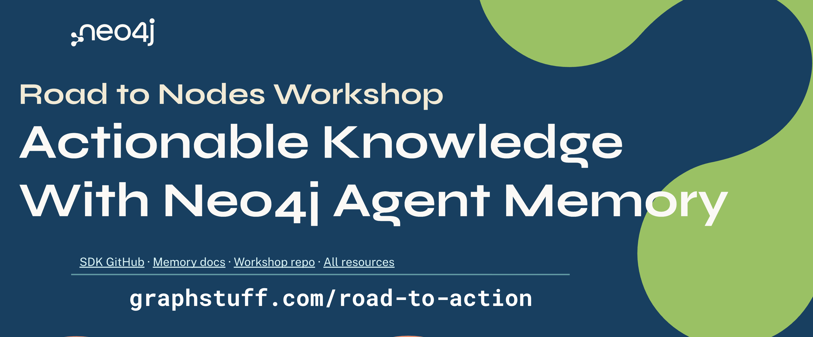

# Road to Agent Memory

[](https://github.com/codespaces/new?repo=johnymontana/road-to-agent-memory)

A 2.5-hour hands-on workshop. You take a PydanticAI customer-support agent
("SupportBot" for the fictional SaaS company **Acme Cloud**) from stateless to
memory-enabled: short-term, long-term and reasoning memory in Neo4j with
`neo4j-agent-memory`, then skill distillation on the Neo4j Agent Memory Service
(NAMS).

You run a complete app and explore it; you don't write code from scratch. Every
action is a `make` target. SQLite is Acme Cloud's system of record; Neo4j is the
agent's memory. New to graphs or agents? See the [glossary](docs/glossary.md).

## Slides

[](https://graphstuff.com/road-to-action)

Open slides at [graphstuff.com/road-to-action](https://graphstuff.com)

## Setup

1. Complete the [pre-work](docs/prework-email.md): a free AuraDB instance, an
   OpenAI API key (as a personal Codespaces secret) and, for module 5, a NAMS key.
   Pre-work ends at `make nams-check`; seeding and distilling happen in the workshop.
2. Click the badge above to open a Codespace (dependencies install automatically).
   Locally, open the repo in a VS Code Dev Container, or run `make setup`.
3. Put your AuraDB URI and password (and `NAMS_API_KEY`) in `.env`.
4. Run `make check`. All green? Run `make dev MODULE=1` and open port 5173 (the
   **Ports** tab in Codespaces, or http://localhost:5173).

## How to work

- **Terminal 1** runs the app: `make dev MODULE=N`. Leave it running.
- **Terminal 2** runs the module's commands below, from the repository root.
- **Next module:** Ctrl+C in terminal 1, `make dev MODULE=<next>`, reload the
  browser and check the **Module N** badge.

Terminal scenarios don't appear in the browser chat. After one runs, click
**Refresh graph** and pick it from the graph-view dropdown: **Saved replay** shows
what happened (replies, tools, SQL, retrieved memory); **Live memory** shows the
nodes it wrote to Neo4j.

In browser chat, **Customer**, **Billing case** and **Authorize selected refund for
this message** must all be set before the agent can refund anything.
**Evaluation lab** (top right) shows the module's `make eval` scorecard. More
detail: [docs/running-the-app.md](docs/running-the-app.md).

## Modules

Each heading links to the participant guide (questions and answers). Each
`module_N/README.md` walks through that stage's code.

### [0 · Setup](docs/modules/module-0.md)
`make check`, then `make dev MODULE=1`.

### [1 · The stateless agent](docs/modules/module-1.md)
| Command | What it does |
|---|---|
| `make s1-baseline` | Looks up Maya's account, then asks for the email she just gave. The agent can't say. |
| `make eval MODULE=1` | Retrieval scorecard (expect no passes) |

**Website:** open the `s1-baseline` Saved replay; try the same two messages in chat.

### [2 · Short-term memory](docs/modules/module-2.md)
| Command | What it does |
|---|---|
| `make s2-return` | Recalls a phrase in the same conversation, then from a new one |
| `make s2-restart` | The same conversation across two separate processes |
| `make eval MODULE=2` | Scorecard: conversation facts now pass |

**Website:** chat, click **New conversation**, ask again. Compare the
`recent_conversation` and `semantic_message` evidence; follow `HAS_MESSAGE` and
`NEXT_MESSAGE` in the graph.

### [3 · Long-term memory](docs/modules/module-3.md)
| Command | What it does |
|---|---|
| `make s3-default` | Extracts entities from a fixed transcript with a generic ontology |
| `make s3-ontology` | The same transcript with the Acme Cloud ontology; compare the two |
| `make eval MODULE=3` | Scorecard: SQL-grounded facts now pass |

**Website:** compare the two **Extractor only** replays. In chat, introduce yourself
as Maya Chen from Northwind Robotics and follow `MENTIONS` to the entities and
their SQL facts. Select **Customer = Maya Chen**, save a contact preference, then
ask what's on file.

Optional, instructor-led: `uv run scripts/instructor.py strict`,
`uv run scripts/instructor.py plan`, `make s3-enrich`.

### [4 · Reasoning memory](docs/modules/module-4.md)
| Command | What it does |
|---|---|
| `make s4-refund` | An authorized $49 refund, recorded as a reasoning trace |
| `make s4-fail` | A $400 refund over the limit, rejected by the server |
| `make s4-refund-repeat` | Compares the same tickets with retrieval of past runs off and on |
| `make eval MODULE=4` | Scorecard: the earlier decision now passes |

**Website:** in Saved replay, read the SQL and receipts; in Live memory with the
**reasoning** layer, follow Trace → Step → ToolCall. In chat, select a customer and
billing case, tick **Authorize**, request the refund, then ask again.

### [5 · Skill distillation (NAMS)](docs/modules/module-5.md)
**Hosted route** (needs a NAMS key with distillation enabled):

| Command | What it does |
|---|---|
| `make nams-check` | Checks the key, that distillation is enabled and that the workspace accepts the seed |
| `make nams-seed` | Writes refund history and traces to your NAMS workspace (run once) |
| `make nams-distill` | Distills, approves and publishes a skill (~1–2 min); downloads `artifacts/distilled/` |
| `make s5-fresh-agent WITH_SKILL=off` | A fresh agent with no memory and no skill |
| `make s5-fresh-agent WITH_SKILL=on` | The same agent with the distilled `SKILL.md` |

**Fallback route:** if NAMS is unavailable, or no package is ready about five
minutes in, compare `WITH_SKILL=off` with `WITH_SKILL=fallback` (the checked-in skill).

**Website (hosted):** tick **NAMS** to follow Skill → version → step → evidence.
Open `artifacts/distilled/SKILL.md` and `provenance.json`.

The governance demo (`make policy-change`, `make nams-drift`, `make nams-redistill`)
is instructor-led in a disposable workspace. Watch; don't run it.

### Wrap-up
`uv run scripts/monday_memory.py` is a minimal take-home recipe. When you're done,
follow [cleanup](docs/teardown.md).

## Other commands

- `make help` lists every target.
- `make module-N` replays a module's commands to catch up (it doesn't switch the
  server). `make module-5` runs the full hosted sequence.
- `make seed` rebuilds the SQLite data. `make setup` never overwrites it.
- `make reset-memory` wipes the Neo4j memory graph; you shouldn't need it.

## Repo layout

```
module_1/ … module_5/  complete agent per stage (app/), plus lab/ and workflows/ where used
lib/                   shared settings, SQL, HTTP transport, graph serialization
web/                   React + NVL frontend (chat, graph, evidence)
scripts/               scenario runner, seeders, eval, NAMS wrappers (run by make)
docs/                  module guides, pre-work, run of show, glossary, ADRs
slides/                instructor deck and diagrams
tests/                 offline and live tests
```

Each module is a complete copy of the agent, so stages compare directly:
`diff -ru module_2/app module_3/app`.

## For maintainers

```bash
uv run pytest tests/ -m "not behavioral" -q                 # offline
RUN_BEHAVIORAL=1 uv run pytest tests/test_behavioral.py -v  # live Neo4j + OpenAI
```

Instructor timing: [run of show](docs/run-of-show.md). Latest live run:
[final run-through notes](docs/workshop-rehearsal-2026-11-05.md). Contributor guidance:
[AGENTS.md](AGENTS.md).

Workshop materials for a Neo4j Labs project: experimental, community-supported,
no SLAs.
